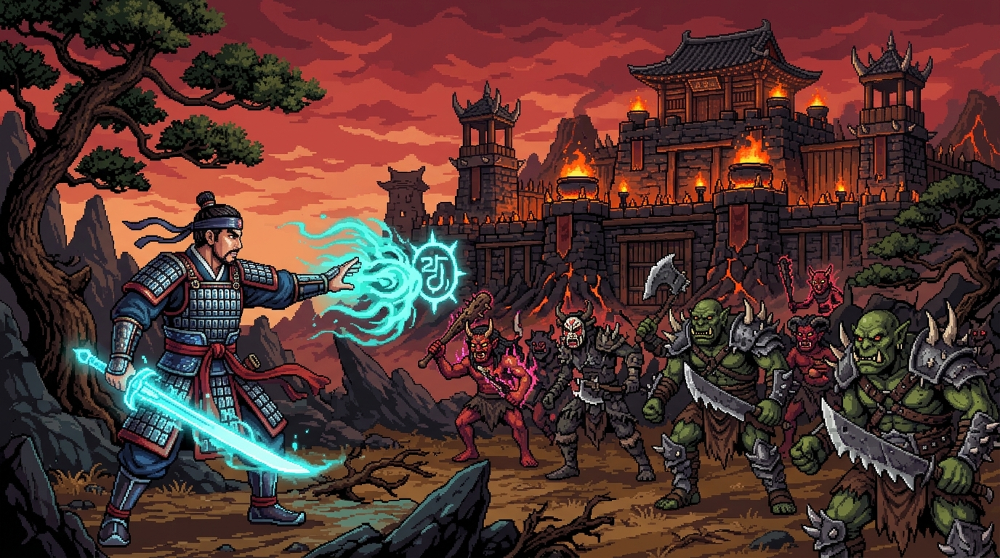
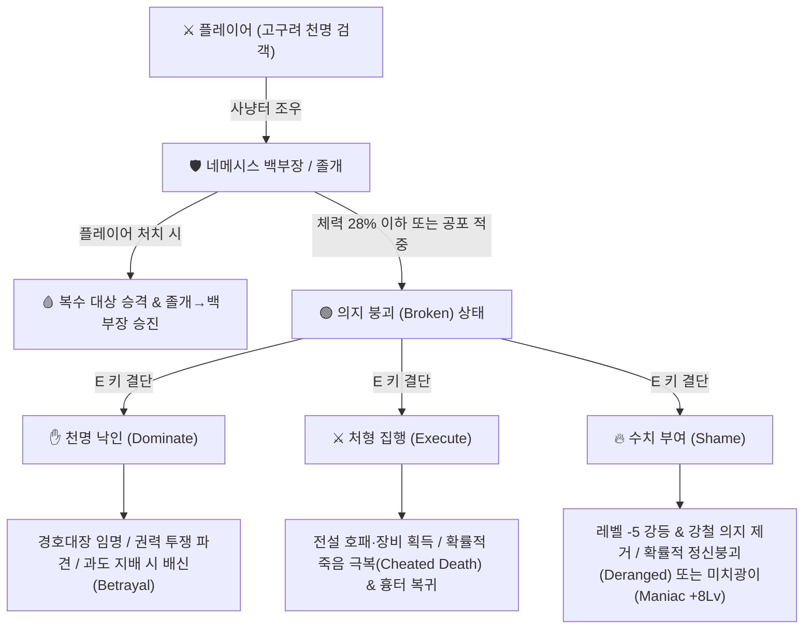
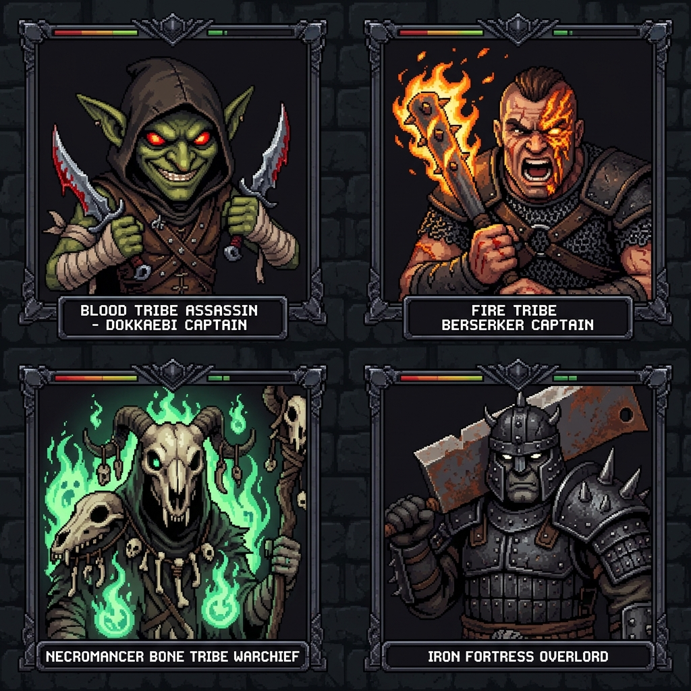
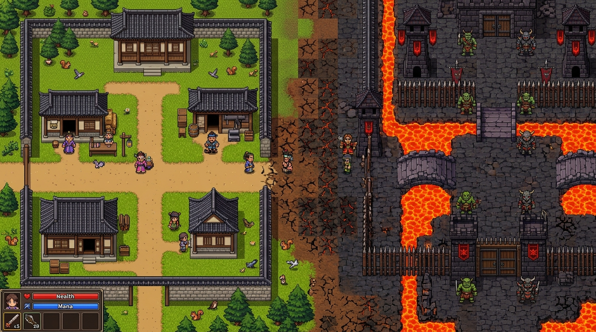

<div align="center">

# ⚔️ 바람의 네메시스: 흉수군단록
### *Nemesis of the Winds: Chronicles of the Beast Legion*

**《미들 어스: 섀도우 오브 모르도르 / 섀도우 오브 워》의 네메시스 시스템(Nemesis System)** 을  
**90년대 클래식 2D 도트 MMORPG 《바람의 나라》** 감성으로 완벽 결합한 웹 기반 2D 픽셀 아트 액션 RPG

[](https://jeiel85.github.io/nemesis-wind/)
[](#)
[](#)
[](#)

<br />



<br />

> *"네놈이 헬파이어로 불태워 죽인 도깨비가 화상 흉터와 화염 면역을 달고 백부장이 되어 돌아왔다!"*  
> **[👉 지금 브라우저에서 바로 플레이하기 (Live Demo & Landing Page)](https://jeiel85.github.io/nemesis-wind/)**

</div>

---

## 🌟 프로젝트 소개 (Overview)

**《바람의 네메시스: 흉수군단록 (Nemesis of the Winds)》** 은 Monolith Productions의 명작 **《Middle-earth: Shadow of Mordor》** 및 **《Shadow of War》** 의 핵심 메커니즘인 **네메시스 시스템(Nemesis System)** 전 요소를 그대로 이식하면서, 게임의 세계관·조작·전투·UI는 대한민국 클래식 2D 탑뷰 픽셀 RPG **《바람의 나라》** 스타일로 구현한 프로젝트입니다.

설치 과정 없이 웹 브라우저에서 즉시 플레이 가능한 **라이브 데모(Live Demo)** 와 게임 시스템을 한눈에 볼 수 있는 **랜딩 페이지(Landing Page)** 가 통합 구성되어 있습니다.

---

## 👑 핵심 네메시스 시스템 (Full Nemesis System Features)



| 네메시스 핵심 요소 | 게임 내 구현 상세 |
| :--- | :--- |
| **군단 계급도 (Army Hierarchy)** | **백부장(Captains 8인) → 전투대장(Warchiefs 3인) → 대군주(Overlord 1인)** 으로 구성된 실시간 군단 서열 트리 (`[N]` 키) |
| **졸개 승진 & 복수 (Promotion & Vendetta)** | 플레이어가 일반 도깨비 졸개나 심지어 **분노한 다람쥐**에게 사망하면, 해당 졸개가 즉시 고유 이름과 칭호(*"바람검객 살해자"*, *"다람쥐 패왕"*)를 얻어 백부장으로 승진하고 **[복수 대상]** 으로 지정됨 |
| **강점·약점·면역 & 전투 적응 (Adaptation)** | 각 지휘관은 절차적으로 생성된 **면역(화염/그림자/빙결/철벽)**, **격노 조건(화염/기습/야수/치명상)**, **치명적 약점 및 공포**를 보유. 동일한 기술 4회 연속 사용 시 **[전투 적응!]** 발동 |
| **밀정 심문 (Worm Interrogation)** | 사냥터의 초록색 오라를 띤 **밀정 졸개(정보원)** 를 처치하거나 `[E]` 키로 심문하여 미확인(`???`) 백부장의 약점과 면역을 해금 |
| **의지 붕괴 & 3대 결단 (Domination Wheel)** | 체력이 28% 이하로 떨어지거나 치명적 공포에 적중당한 적은 **[의지 붕괴]** 상태가 되며 `[E]` 키로 **[천명 낙인(지배)] / [처형 집행] / [수치 부여]** 선택 가능 |
| **강철 의지 & 광기/미치광이 (Shame & Maniac)** | 고레벨 지휘관의 **[강철 의지]** 는 **[수치 부여]** 로만 파괴 가능. 수치를 당한 적은 확률적으로 이성을 잃고 *"다람쥐를 뿌려라!"* 만 외치는 **정신붕괴(Deranged)** 상태가 되거나, 오히려 레벨이 +8 폭증하는 **미치광이(Maniac)** 로 각성 |
| **죽음 극복 & 흉터 (Cheated Death & Scars)** | 처형당한 백부장이 확률적으로 죽음을 극복하고 **화상 흉터, 애꾸눈 안대, 강령술 봉합선** 등 시각적 흉터와 새로운 칭호(*"화염에서 돌아온 자"*)를 달고 사냥터 진입 시 기습 |
| **배신 & 구원자 난입 (Betrayal & Savior)** | 아군 백부장을 과도하게 거느리면 확률적으로 낙인을 끊고 **배신(Betrayal)** 하며, 반대로 플레이어가 치명타를 맞을 때 아군 경호대장이 난입해 목숨을 구해주는 **구원자(Savior)** 연출 발동 |

---

## 🏯 《바람의 나라》 클래식 월드 & 5대 부족

<div align="center">
  
  
</div>

### 🗺️ 4대 구역 (Zones)
1. **🏯 국내성 남문 & 왈숙네 주막 (안전 구역)**: 주모 왈숙네에게서 국밥으로 체력/마력을 100% 회복하고 천명단에서 군단을 지휘하는 마을 거점
2. **🌲 국내성 외곽 사냥터 (Lv.3~9)**: 클래식 다람쥐, 토끼, 밀정 졸개와 초급 백부장 3인이 배회하는 초원
3. **👻 흉가 & 도깨비 숲 (Lv.9~16)**: 흉가 망령병과 중급 백부장들이 암살과 사령술로 매복하는 위험 지대
4. **🌋 혈마성채 심층부 (Lv.16~25+)**: 용암 해자 너머 3인의 전투대장(Warchiefs)과 **혈마대군주 아크라카(Overlord)** 가 군림하는 최종 성채

### 👹 5대 흉수 부족 (Tribes)
- 🩸 **혈마족 (Blood Tribe)**: 암살검과 출혈 저주를 다루는 자객 부족
- 🔥 **화염깨비족 (Fire Dokkaebi)**: 도깨비불과 화약 철퇴로 전장을 불태우는 광전사 부족
- 💀 **해골망령족 (Bone Necro)**: 흉가와 인형굴의 사령술로 죽음을 되살리는 강령술 부족
- 🐗 **야수사냥족 (Beast Feral)**: 괴수와 폭주 다람쥐 무리를 조련하는 야수 부족
- ⚙️ **기계장인족 (Iron Machine)**: 강철 중갑과 방패로 정면 돌파를 불허하는 중장갑 부족

---

## 🎮 조작법 및 기술 목록 (Controls & Skills)

| 단축키 | 기술 / 행동명 | 설명 및 네메시스 연계 효과 |
| :---: | :--- | :--- |
| `W` `A` `S` `D` / `방향키` | **4방향 이동** | 사냥터 이동 및 포탈 진입 |
| `Space` | **⚔️ 건곤대나이 (평타)** | 전방 근접 검격 (`건곤대나이 취약` 약점 공략) |
| `1` | **🔥 헬파이어 (Hellfire)** | 클래식 바람의 나라 필살 화염주 (`화염 공포` 적중 시 즉시 붕괴 / `화염 격노` 유발 주의) |
| `2` | **⚡ 초혼비무 (Shadow Strike)** | 원거리 대상에게 순간이동하여 베기 (`초혼비무 취약` 약점 공략) |
| `3` | **❄️ 삼매빙폭 (Elemental Nova)** | 주변 광역 빙염 폭발 (`빙결/폭풍 취약` 약점 공략) |
| `4` | **✋ 경호원 & 신수 소환** | 지배한 아군 경호대장 및 영혼 다람쥐왕 소환 (`야수/다람쥐 공포` 즉시 붕괴 유발) |
| `5` | **💚 공력을운 (Heal)** | 마력을 소모하여 체력 즉시 회복 |
| `E` | **👑 제압 / 심문 / 상호작용** | **[붕괴]** 상태인 백부장에게 **낙인·처형·수치** 결단 / 밀정 심문 / 주막 회복 |
| `N` | **👑 군단 계급도 열람** | 백부장·전투대장·대군주의 서열, 약점 정보, 경호대장 지정 및 위치 추적 |
| `T` | **⏳ 시간 경과** | 진행 중인 권력 투쟁(결투/매복/처형/연회) 자동 결판 및 빈 백부장 석 충원 |

> 💡 **이스터에그**: 우측 하단 바람 채팅창에 `다람쥐를 뿌려라` 를 입력하거나 `[🐿️ 다람쥐를 뿌려라!]` 버튼을 누르면 전장에 폭주 다람쥐 무리가 소환됩니다!

---

## 🛠️ 그래픽 애셋 생성 및 로컬 실행 (Assets & Local Development)

본 프로젝트의 2D 픽셀 아트 스프라이트 시트(`assets/sprites/*.png`)와 프로모션 아트워크(`assets/art/*.png`)는 **Codex CLI** 기반의 순수 Node.js 픽셀 매트릭스 생성기(`scripts/generate_pixel_assets.mjs`)와 절차적 오프스크린 캔버스 도트 렌더러(`src/sprites.js`)로 제작되었습니다.

```bash
# 1. 저장소 클론
git clone https://github.com/jeiel85/nemesis-wind.git
cd nemesis-wind

# 2. 픽셀 아트 스프라이트 시트 재생성 (선택 사항 - 기본 포함됨)
npm run assets

# 3. 로컬 웹 서버 실행
npm start
```

---

## 📂 디렉토리 구조 (Project Structure)

```text
nemesis-wind/
├── index.html                        # 라이브 데모 게임 화면 + 소개 랜딩 페이지 통합 엔트리
├── styles.css                        # 클래식 바람의 나라 + 모르도르 다크 골드 UI 스타일시트
├── package.json                      # 프로젝트 메타데이터 및 실행 스크립트
├── scripts/
│   └── generate_pixel_assets.mjs     # Codex CLI로 작성된 2D 픽셀 스프라이트 PNG 생성기
├── assets/
│   ├── art/                          # 히어로 배너, 부족별 초상화, 타일맵 일러스트
│   └── sprites/                      # 플레이어, 백부장, 몬스터, 타일셋, 이펙트 PNG & manifest.json
└── src/
    ├── game.js                       # 메인 2D 게임 루프, 전투/스킬 판정, 모달 및 HUD 제어
    ├── nemesis.js                    # 네메시스 시스템 코어 (계급, 약점/면역, 승진, 죽음극복, 광기, 배신)
    ├── world.js                      # 4대 구역(국내성, 외곽, 흉가, 혈마성채) 2D 타일맵 빌더
    ├── sprites.js                    # 16비트 도트 스프라이트 시트 로더 & 절차적 흉터/부족 합성 엔진
    └── audio.js                      # Web Audio API 기반 레트로 효과음 신디사이저
```

---

## 📜 라이선스 (License)

MIT License © 2026 jeiel85
